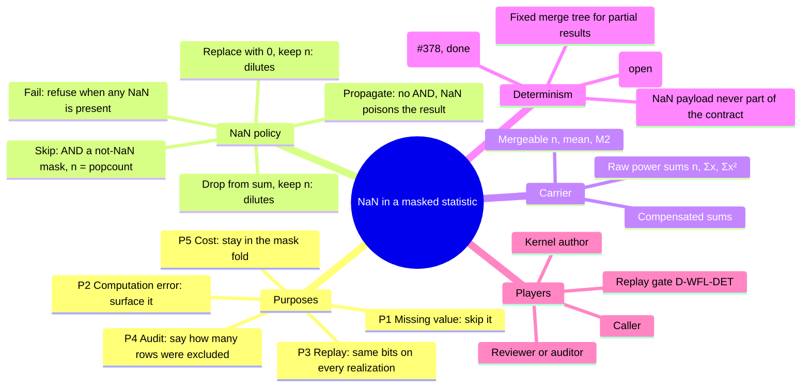

# NaN exclusion for masked statistics: scratch mindmap

> **Status: SCRATCH, for later examination.** Nothing here is built, measured
> or decided. It maps purposes against the benefits and costs of each option,
> so a later session can pick a design without re-deriving the trade-offs.
> Context: the follow-up to #378 (wasm `mul_add` rounds once on every
> realization) and lance-graph `D-WFL-DET` (replay determinism).

## The question

When a masked statistic (n, mean, variance) meets a NaN, what should happen?
And what must hold so that the answer is the same on every realization?

The failure to avoid is **dilution**. The sums and the sample count n stop
describing the same rows, which skews the mean and the variance without any
signal that it happened.

## Mindmap

## Purposes

| id | purpose | what it requires |
|---|---|---|
| P1 | A NaN marks a missing measurement: ignore it | exclude it from the sums **and** from n |
| P2 | A NaN marks a computation error: do not hide it | the result is NaN, or the call is refused |
| P3 | Replay: identical input gives identical bits on every realization | single-rounding `mul_add` (#378), a fixed summation order, a fixed merge tree |
| P4 | Audit: the exclusion must be visible | `n_excluded = popcount(selection & !not_nan)` returned with the result |
| P5 | Cost: no new engine, no per-row objects | exclusion as a mask AND; the fold stays a mask fold |

## Payoffs: NaN policy by purpose

`+` serves the purpose, `0` neutral, `−` works against it, `−−` defeats it.

| policy | P1 missing | P2 error | P3 replay | P4 audit | P5 cost | note |
|---|---|---|---|---|---|---|
| **Skip** (`sel & not_nan`, n = popcount) | `+` | `−` hides errors | `+` mask is exact | `+` with `n_excluded` | `+` one AND | dilution impossible by construction |
| **Propagate** (IEEE default) | `−−` one gap kills the group | `+` | `+` NaN in every realization | `0` | `+` free | the current behaviour |
| **Replace with 0, keep n** | `−−` dilutes | `−−` hides | `+` | `−−` silent | `+` | locally cheapest, globally worst |
| **Drop from sum, keep n** | `−−` dilutes | `−−` | `+` | `−−` | `+` | the classic hand-rolled bug |
| **Fail on any NaN** | `−` | `+` | `+` | `+` | `0` an extra check | strict; good for pipelines that must be clean |

No policy dominates on every purpose. Skip and Propagate are each best for one
NaN meaning, and both are honest. The two "keep n" policies are never best on
any purpose; they are only cheaper to write.

## Game-theory reading

**Players and their local incentives:**

- **Kernel author:** wants the smallest surface. The temptation is to bake one
  policy into the kernel.
- **Caller:** wants the number now. The temptation is the cheapest policy:
  replace with 0, or skip without reporting.
- **Replay gate (D-WFL-DET):** wants identical bits. It does not care which
  policy is used, only that it is fixed and recorded.
- **Reviewer or auditor:** wants to see what was excluded. They cannot see a
  silent policy.

**Why the bad outcome happens:**

- *Replace with 0, keep n* is the defecting strategy. It is locally cheapest
  for the caller, and the cost lands on someone else: whoever reads the
  variance later. That is a negative externality with no signal.
- Because the harm is silent, the repeated game never punishes it. Nothing
  fails, so the defection persists.

**Design moves that change the payoffs:**

1. **The kernel is policy-free** (as the integer `PowerSums` already are:
   "what those sums mean is decided above this layer"). Policy is a mask the
   caller chooses, so the author never imposes one meaning on every caller.
2. **Make the honest options the cheapest to write.** If skip is one AND with
   a provided `not_nan_*_to_mask`, a correct skip costs less than a hand-rolled
   zero-fill. Then the defecting strategy is no longer locally cheapest.
3. **Make exclusion observable.** Returning `n_excluded` beside the result
   turns a silent defection into a visible one. Once the cost can be seen, the
   reviewer can act on it.
4. **Make dilution unrepresentable.** If n is *derived* from the same mask that
   selects the sums (`popcount(sel & valid)`), there is no API through which n
   and the sums can disagree. This is the strongest move: it removes the bad
   strategy instead of discouraging it.

**Resulting equilibrium (hypothesis, unbuilt):** the caller chooses Skip or
Propagate per use, n always matches the sums, exclusions are reported, and the
replay gate sees one fixed fold.

## Payoffs: carrier by purpose

| carrier | accuracy | replay (P3) | mergeable | cost | note |
|---|---|---|---|---|---|
| Raw `n, Σx, Σx²` | `−−` variance as Σx² − (Σx)²/n cancels catastrophically for large means | `+` with fixed order | `+` add fields | `+` cheapest | fine for integers (the existing `PowerSums`), weak for floats |
| `n, mean, M2` (Chan et al. pairwise merge) | `+` stable | `+` with a fixed merge tree | `+` | `0` a division per merge | the usual float choice |
| Compensated sums (Kahan or two-sum on Σx, Σx²) | `+` | `+` with fixed order | `0` the merge must carry error terms | `−` about twice the work | combines with either carrier above |

Open choice: `n, mean, M2` is the likely default for floats, while the integer
`PowerSums` stay as they are (exact, so no accuracy issue).

## Determinism ladder (what P3 needs, in order)

1. **Single-rounding `mul_add`:** DONE in #374/#378, checked bit for bit
   against the integer oracle on every realization.
2. **Fixed summation order inside the fold:** OPEN. `reduce_sum` order differs
   per backend today (for example a balanced tree on wasm, a sequential fold on scalar), so a
   deterministic fold must define its own lane-blocked order rather than call
   `reduce_sum`.
3. **Fixed merge tree for partial results** (threads, tiles): OPEN.
4. **Exact validity mask:** free, because `x == x` is exact on every
   realization.
5. **NaN payload and NaN sign:** never part of the contract. A propagated NaN
   is "some NaN".

## Candidate work (unscheduled)

| step | what | size | depends on |
|---|---|---|---|
| S1 | `not_nan_f64_to_mask` / `not_nan_f32_to_mask`: all realizations, parity group (NaN payloads, ±0, inf, subnormal) | small | — |
| S2 | Masked float fold with a fixed order, carrier `n, mean, M2` | medium | S1, the carrier decision |
| S3 | `n_excluded` reporting convention | small | S1 |
| S4 | D-WFL-DET states its contract: same selection & validity mask + same fixed-order fold ⇒ same bits, NaN payload excepted | lance-graph, owner's call | S2 |

## Open questions for the operator

- Which NaN meaning dominates in the actual consumers (missing data or error)?
  Or do both occur, so the per-call choice really matters?
- Should a *Fail* policy exist as a first-class option, or is Propagate enough?
- Carrier for floats: `n, mean, M2`, or raw power sums plus compensation?
- Does replay need determinism across thread and tile counts (S3 of the
  ladder), or only across realizations for a fixed partition?
